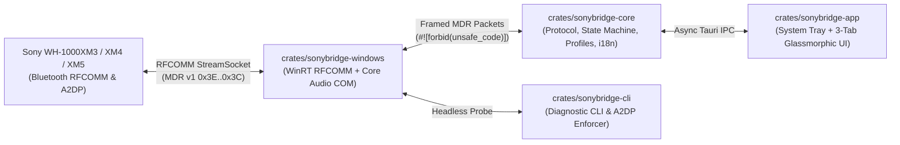

<div align="center">

# SonyBridge 🎧 🌉

**A lightweight, native Windows 10/11 system tray companion that brings the full power of the *Sony | Headphones Connect* app to the PC desktop for the WH-1000XM3, WH-1000XM4, WH-1000XM5, and WF series.**

[](https://github.com/DooperDrew/sonybridge/releases/latest)
[](https://github.com/DooperDrew/sonybridge/actions/workflows/ci.yml)
[](https://www.rust-lang.org/)
[](LICENSE)
[](https://microsoft.com/windows)
[](#performance--safety-budgets)
[-success.svg)](#core-philosophy)

<br/>

| 📖 [User Guide](docs/user-guide.md) | 🪄 [Setup Wizard](scripts/setup-wizard.ps1) | 🧪 [Hardware QA](docs/06-qa-and-validation.md) | 📦 [WinGet & Releases](docs/release-methodology.md) | 🤝 [Community Plan](docs/08-community-and-growth-strategy.md) | 🤖 [Architecture](docs/multi-agent-methodology.md) |
|:---:|:---:|:---:|:---:|:---:|:---:|

</div>

---

## The Problem

Sony's flagship wireless headphones (**WH-1000XM3**, **WH-1000XM4**, **WH-1000XM5**, and **WF-1000XM4/XM5**) deliver world-class acoustics and Active Noise Canceling, but when paired with Windows 10 or 11:
- **Muffled "Hands-Free AG" audio degradation:** Whenever Discord, Teams, Zoom, or a game touches the microphone, Windows switches the headphones into the legacy 8 kHz mono `Hands-Free AG Audio` (`HFP`) profile, ruining music and system audio.
- **No official Windows companion app:** Sony only ships *Sony | Headphones Connect* on iOS and Android. Adjusting Ambient Sound levels, Wind Noise Reduction, Clear Bass, or the 5-band hardware DSP Equalizer normally requires disconnecting from your PC and picking up your phone.
- **Opaque battery & telemetry:** Windows Bluetooth settings provide coarse or stale battery numbers and zero insight into the headset's active ANC or DSP state.
- **Bloated workarounds:** Existing alternatives often require virtual kernel audio drivers, heavy Electron wrappers (>150 MB RAM), or manual command-line scripts.

**SonyBridge solves all of this natively in user space with zero kernel drivers, 0% idle CPU, and an instant system tray flyout.**

---

## Core Philosophy

1. **Invisible & Lightweight (`0%` Idle CPU, `<= 35 MB` RAM):** Purely event-driven Bluetooth RFCOMM socket I/O and UI IPC. Zero background polling loops.
2. **Zero Kernel Drivers & Zero Elevation:** Operates 100% in standard user mode using official WinRT `RfcommDeviceService` and Windows Core Audio `IMMDeviceEnumerator` / `IPolicyConfig` COM interfaces.
3. **Pure Safe Protocol Core (`#![forbid(unsafe_code)]`):** All Sony MDR v1/v2 byte-stuffed wire framing (`0x3E`..`0x3C`, `0x3D` escape), checksums, and state transitions are isolated in a platform-agnostic, 100% unit-tested core crate.
4. **100% Offline & Private:** Zero telemetry, zero analytics, zero cloud accounts, and zero network requests.

---

## ✨ Key Features

- **Authentic Sony MDR Protocol v1 & v2 over RFCOMM:** Communicates directly with your Sony WH-1000XM3 (`96cc203e-5068-46ad-b32d-396ceebe3928`) and v2 models (`956c7b26-d49a-4ba8-b03f-b17d393cb6e2`) using byte-stuffed `DATA_MDR` (`0x0C`) and `ACK` (`0x01`) frames with verified modulo-256 checksums.
- **Active Noise Canceling (ANC) & 20-Step Ambient Sound (`0x68`):** Switch instantaneously between **ANC On (Dual Noise Sensor)**, **Wind Noise Reduction**, **20-level Ambient Sound** (`1..=20`) with **Focus on Voice** passthrough, and **Off**.
- **Hardware 5-Band Equalizer & Clear Bass (`0x58`):** Tune hardware DSP bands (`400 Hz`, `1 kHz`, `2.5 kHz`, `6.3 kHz`, `16 kHz`) from `-10` to `+10` dB and **Clear Bass** (`-10..+10`) directly in headphone EEPROM memory.
- **1-Click Sound Profiles:** Instantly switch between **Focus (Max ANC)**, **Office / Calls**, **Cinema / Bass Boost**, and **Studio Reference**.
- **Smart Windows Audio Endpoint Sanitizer (`IPolicyConfig`):** Detects muffled `Hands-Free AG Audio` (`HFP`) endpoints and enforces high-resolution **Stereo (`A2DP`)** across Windows Console, Multimedia, and Communications roles with a single click (or automatically on connect).
- **3-Tab Adaptive Flyout & Live Wire Frame Inspector:** Inspect every outgoing and incoming hexadecimal MDR packet in real time from the **Architecture & Wire Inspector** tab.
- **Bilingual UI (`EN` / `IT`) & First-Run Onboarding Wizard:** Instant English/Italian localization and guided 3-step setup modal.

---

## 📥 Download & Installation

SonyBridge requires **no administrator privileges** and provides four flexible installation and distribution channels:

### Option 1: Microsoft WinGet (Recommended)
Install directly using the official Windows Package Manager:
```powershell
# Install latest release from WinGet community repository:
winget install DooperDrew.SonyBridge

# Or install directly from the local repository manifest:
winget install --manifest packaging/winget/manifests/d/DooperDrew/SonyBridge/0.2.0/
```

### Option 2: Scoop Package Manager
Install via Scoop for automatic `PATH` management (`sonybridge` and `sonybridge-cli` shims) and easy updates:
```powershell
scoop install https://raw.githubusercontent.com/DooperDrew/sonybridge/main/packaging/scoop/sonybridge.json
```

### Option 3: Guided Windows Setup Wizard (Zero-Elevation GUI)
1. Download the latest release archive ([**`SonyBridge-v0.2.0-windows-x64.zip`**](https://github.com/DooperDrew/sonybridge/releases/download/v0.2.0/SonyBridge-v0.2.0-windows-x64.zip)) from [GitHub Releases](https://github.com/DooperDrew/sonybridge/releases/latest).
2. Extract the ZIP and double-click **`setup.cmd`** (or run `.\setup-wizard.ps1` in PowerShell).
3. The graphical Windows Forms setup wizard lets you:
   - Choose your installation directory (defaults to `%LOCALAPPDATA%\Programs\SonyBridge`).
   - Create **Start Menu** (`SonyBridge` & `SonyBridge Diagnostic Probe`) and **Desktop** shortcuts.
   - Configure automatic launch at Windows sign-in (`HKCU\Software\Microsoft\Windows\CurrentVersion\Run\SonyBridge`).
   - Automatically register in Windows **Installed apps** (Settings &rarr; Apps / Control Panel) with full 1-click uninstallation support.

*For silent, console, or scripted deployments:*
```powershell
# Silent zero-touch installation:
.\setup-wizard.ps1 -Silent

# Console-only interactive setup wizard:
.\setup-wizard.ps1 -NoGui

# Direct user-space installer / uninstaller scripts:
.\install.ps1
.\uninstall.ps1 -Silent -PurgeData
```

### Option 4: Portable ZIP (No Installation Required)
1. Download and extract [`SonyBridge-v0.2.0-windows-x64.zip`](https://github.com/DooperDrew/sonybridge/releases/download/v0.2.0/SonyBridge-v0.2.0-windows-x64.zip).
2. Double-click **`sonybridge-app.exe`** (or run `.\sonybridge-cli.exe probe` for headless diagnostics).
3. The headphone tray icon appears immediately in the Windows notification area. Zero registry keys touched—runs cleanly from any local folder or USB drive.

---

## 🏗️ Architecture Overview

SonyBridge is structured as a modular 4-crate Rust Cargo workspace separating pure protocol logic from Windows OS integration and UI:



### Workspace Structure

| Crate | Path | Responsibility |
|---|---|---|
| [`sonybridge-core`](crates/sonybridge-core) | `crates/sonybridge-core` | Pure Sony MDR v1/v2 wire protocol (`0x3D` byte stuffing, modulo-256 checksums, ANC `0x68`, EQ `0x58`, Battery `0x12`), state machine, sound profiles, and EN/IT i18n. `#![forbid(unsafe_code)]`, zero OS dependencies. |
| [`sonybridge-windows`](crates/sonybridge-windows) | `crates/sonybridge-windows` | Windows WinRT RFCOMM `StreamSocket` transport, Core Audio `IMMDeviceEnumerator` + `IPolicyConfig` A2DP routing sanitizer, and `HKCU\...\Run` startup manager. |
| [`sonybridge-cli`](crates/sonybridge-cli) | `crates/sonybridge-cli` | Headless diagnostic CLI (`sonybridge-cli probe` and `sonybridge-cli enforce-a2dp`). |
| [`sonybridge-app`](crates/sonybridge-app) | `crates/sonybridge-app` | Tauri v2 Windows 10/11 system tray companion with 3-tab glassmorphic flyout UI, first-run onboarding wizard, and live hexadecimal wire inspector. |

---

## ⚡ Performance & Safety Budgets

| Metric | Target Budget | Design Guarantee |
|---|---|---|
| **Idle CPU Usage** | **`0.0%`** | Fully event-driven RFCOMM socket I/O and UI state transitions. Zero polling loops. |
| **Idle RAM Footprint** | **`<= 35 MB`** | Native Rust backend + shared Windows 10/11 Edge WebView2 runtime (~22 MB measured). |
| **Command Latency** | **`< 80 ms`** | Sub-millisecond packet encoding (`< 1 ms`) + 75 ms slider debounce to prevent RFCOMM congestion. |
| **User-Mode Safety** | **100% Safe** | Zero kernel drivers (`.sys`), zero UAC elevation, `#![forbid(unsafe_code)]` in `sonybridge-core`. |
| **Release Binary Size** | **`< 10 MB`** | Optimized release binaries (`5.07 MB` for `sonybridge-app.exe`, `1.45 MB` for `sonybridge-cli.exe`). |

---

## 🛠️ Building & Running from Source

```powershell
$env:PATH = "$env:USERPROFILE\.cargo\bin;$env:PATH"

# 1. Run the 4-step Cargo verification gate
cargo fmt --all -- --check
cargo clippy --workspace --all-targets -- -D warnings
cargo test --workspace
cargo build --workspace --release

# 2. Run headless diagnostic probe
cargo run -p sonybridge-cli -- probe

# 3. Package portable release archive (.zip) & generate WinGet/Scoop manifests
.\scripts\package-release.ps1 -Version "0.2.0" -SkipBuild
.\scripts\generate-manifests.ps1 -Version "0.2.0"
```

---

## 🗺️ Roadmap & Milestones

Progress is tracked 1:1 via [GitHub Milestones](https://github.com/DooperDrew/sonybridge/milestones) and [GitHub Issues](https://github.com/DooperDrew/sonybridge/issues):

- [x] **[M0: Protocol & Windows Audio Spike 🔬](https://github.com/DooperDrew/sonybridge/issues/1)** — Sony MDR v1/v2 RFCOMM framing, Core Audio `IPolicyConfig` vtable, and `sonybridge-cli probe`. See [docs/m0-spike-findings.md](docs/m0-spike-findings.md).
- [x] **[M1: Pure Core Protocol & State Machine](https://github.com/DooperDrew/sonybridge/issues/2)** — `#![forbid(unsafe_code)]` canonical & byte-stuffed (`0x3D`) codec, checksums, and `HeadphoneStateMachine`.
- [x] **[M2: WinRT Bluetooth RFCOMM Transport](https://github.com/DooperDrew/sonybridge/issues/3)** — `WinRtRfcommTransport` over `RfcommDeviceService` and `StreamSocket`.
- [x] **[M3: Windows Core Audio Endpoint Sanitizer](https://github.com/DooperDrew/sonybridge/issues/4)** — `IMMDeviceEnumerator` discovery and `IPolicyConfig::SetDefaultEndpoint` Stereo (`A2DP`) enforcement.
- [x] **[M4: Tauri v2 System Tray & IPC Bridge](https://github.com/DooperDrew/sonybridge/issues/5)** — System tray icon, context menu, single-instance protection, and async IPC commands.
- [x] **[M5: ANC, Ambient Sound & 5-Band Equalizer UI](https://github.com/DooperDrew/sonybridge/issues/6)** — Glassmorphic UI, WH-1000XM3 opcodes (`0x68`, `0x58`), [Wire Inspector (`#12`)](https://github.com/DooperDrew/sonybridge/issues/12), and [1-Click Sound Profiles (`#13`)](https://github.com/DooperDrew/sonybridge/issues/13).
- [x] **[M6: Bilingual Localization (`EN`/`IT`) & Onboarding](https://github.com/DooperDrew/sonybridge/issues/7)** — English/Italian locale bundles, persistent `AppConfig`, and [Guided Setup Wizard & First-Run Onboarding (`#14`)](https://github.com/DooperDrew/sonybridge/issues/14).
- [x] **[M7: Registry Autostart & Power Controls](https://github.com/DooperDrew/sonybridge/issues/8)** — `HKCU\...\Run` startup manager, Auto-Power Off (`0x28`), and Touch Sensor lock (`0xD8`).
- [x] **[M8: Release Packaging, Portable ZIP & Manifests](https://github.com/DooperDrew/sonybridge/issues/9)** — Zero-build portable `.zip` releases (`v0.1.0` & `v0.2.0`), WinForms setup wizard, Inno Setup script, and WinGet/Scoop manifests.
- [ ] **M9: Empirical Physical Hardware QA (WH-1000XM3)** — Physical headphone validation matrix ([`#10`](https://github.com/DooperDrew/sonybridge/issues/10)) and sleep/resume recovery ([`#11`](https://github.com/DooperDrew/sonybridge/issues/11)). See [docs/06-qa-and-validation.md](docs/06-qa-and-validation.md).
- [x] **[M10: Multi-Model Expansion & Community Ecosystem](https://github.com/DooperDrew/sonybridge/issues/15)** — Multi-agent methodology, Copilot Cloud Agent integration, and community distribution strategy.

---

## 📚 Documentation Index

- [Documentation Hierarchy & Reading Order (`docs/README.md`)](docs/README.md)
- [01 — Vision & Problem Statement](docs/01-vision.md)
- [02 — Requirements & Budgets](docs/02-requirements.md)
- [03 — System Architecture](docs/03-architecture.md)
- [04 — UX & System Tray Specification](docs/04-ux.md)
- [05 — Roadmap & Milestones](docs/05-roadmap.md)
- [06 — QA & Hardware Validation Matrix](docs/06-qa-and-validation.md)
- [07 — UX Enhancements & v0.2.0 Evolution](docs/07-ux-and-improvements.md)
- [08 — Community Growth & Distribution Strategy](docs/08-community-and-growth-strategy.md)
- [Multi-Agent & GitHub Copilot Cloud Methodology](docs/multi-agent-methodology.md)
- [Release & Versioning Methodology](docs/release-methodology.md)
- [M0 Protocol & Core Audio Spike Findings](docs/m0-spike-findings.md)
- [Comprehensive User Guide & Manual](docs/user-guide.md)
- [Lessons Learned](docs/lessons-learned.md)
- [Model Fallback Log](docs/model-fallback-log.md)
- [Contributing & Agent Workflow](CONTRIBUTING.md)
- [Security Policy](SECURITY.md) | [Support Guide](SUPPORT.md) | [Changelog](CHANGELOG.md)

## License

This project is licensed under the [MIT License](LICENSE).
