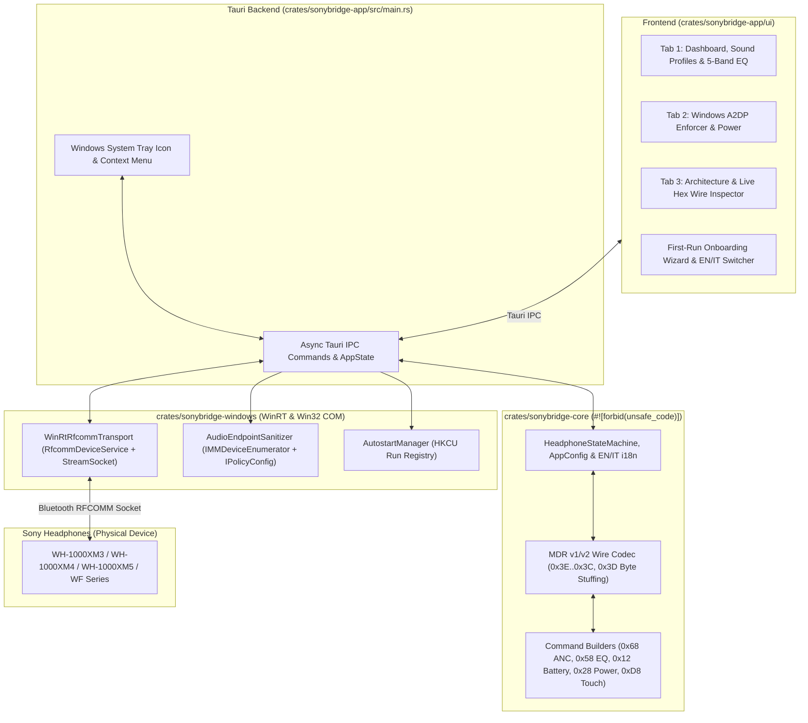

# 03 — Architecture

> Status: **APPROVED & IMPLEMENTED (`v0.2.0`)**.

## Tech Stack (see [`decisions/0001-rust-tauri-stack.md`](decisions/0001-rust-tauri-stack.md))
| Concern | Choice | Rationale |
|---|---|---|
| Language / runtime | Rust (stable 2021) | Memory safety, native Win32/WinRT interop, zero runtime overhead, predictable memory. |
| Desktop App & Tray | Tauri v2 (`tray-icon`) | Native Windows WebView2 embedding, native OS system tray menu, low memory footprint (`~22 MB` vs Electron's `150+ MB`). |
| Windows Bluetooth API | `windows` crate `v0.58` (`Windows::Devices::Bluetooth::Rfcomm` + `StreamSocket`) | Official Microsoft WinRT bindings for Rust; connects directly to Sony MDR v1 (`96cc203e-5068-46ad-b32d-396ceebe3928`) and MDR v2 (`956c7b26-d49a-4ba8-b03f-b17d393cb6e2`). |
| Audio Endpoint Control | Windows Core Audio COM API (`IMMDeviceEnumerator`, `IPolicyConfig`) | Native user-mode COM interface for enumerating audio render endpoints and enforcing Stereo (`A2DP`) across Console, Multimedia, and Communications roles. |
| Startup Integration | Windows Registry (`HKCU\Software\Microsoft\Windows\CurrentVersion\Run`) | Per-user logon autostart without requiring UAC Administrator elevation. |
| UI Frontend | Vanilla HTML5 / CSS3 / ES6 JS (3-Tab Glassmorphic Flyout) | Zero heavy bundler overhead, instant rendering, live hexadecimal wire inspector, and bilingual EN/IT dictionary support. |
| Build, Packaging & CI | Cargo workspace + PowerShell packaging (`package-release.ps1`, `setup-wizard.ps1`, `generate-manifests.ps1`) + GitHub Actions (`ci.yml`, `release.yml`) | Deterministic builds, zero-elevation WinForms setup wizard, and automated WinGet/Scoop manifest generation. |

---

## Component / Process Model



---

## Module Boundaries (Designed for Parallel Multi-Agent Work)

```
crates/
├── sonybridge-core/               # Pure protocol logic, #![forbid(unsafe_code)], zero OS deps, 14 unit tests
│   └── src/
│       ├── lib.rs
│       ├── protocol.rs            # Canonical + Sony MDR v1 byte-stuffed framing (0x3E..0x3C, 0x3D escape, checksum)
│       ├── commands.rs            # 0x12/0x13 Battery, 0x68 NC/Ambient, 0x58 5-Band EQ & Clear Bass, 0x28 Power, 0xD8 Touch
│       ├── state.rs               # Deterministic HeadphoneStateMachine
│       ├── config.rs              # Persistent AppConfig & 4 built-in SoundProfiles (Focus, Office, Cinema, Reference)
│       ├── i18n.rs                # Bilingual English (en) & Italian (it) localization bundles
│       └── transport.rs           # RfcommTransport trait & MockRfcommTransport
│
├── sonybridge-windows/            # Windows OS integrations (WinRT Bluetooth RFCOMM, Core Audio COM, Registry)
│   └── src/
│       ├── lib.rs
│       ├── bluetooth.rs           # WinRtRfcommTransport over RfcommDeviceService & StreamSocket (DataWriter/DataReader)
│       ├── audio.rs               # AudioEndpointSanitizer (IMMDeviceEnumerator + IPolicyConfig::SetDefaultEndpoint)
│       └── autostart.rs           # AutostartManager for HKCU\Software\Microsoft\Windows\CurrentVersion\Run\SonyBridge
│
├── sonybridge-cli/                # Headless diagnostic CLI & A2DP enforcer
│   └── src/
│       └── main.rs                # `sonybridge-cli probe` and `sonybridge-cli enforce-a2dp`
│
└── sonybridge-app/                # Tauri v2 Desktop & System Tray application
    ├── src/
    │   └── main.rs                # Tray lifecycle, IPC commands, live wire_hex telemetry, profile switching
    ├── locales/
    │   ├── en.toml                # English UI locale dictionary
    │   └── it.toml                # Italian UI locale dictionary
    └── ui/
        ├── index.html             # 3-tab flyout layout + First-Run Onboarding Wizard modal
        ├── style.css              # Glassmorphic dark theme with Sony copper/cyan accents
        └── app.js                 # Reactive state binding, debounced EQ/ANC dispatch, live hex wire log
```

---

## Key Technical Designs

### 1. Authentic Sony WH-1000XM3 MDR v1 Byte-Stuffed Wire Framing
- **Wire Packet Layout:**
  - Start Marker: `0x3E` (`>`)
  - Data Type: `0x0C` (`DATA_MDR`) or `0x01` (`ACK`)
  - Sequence Number: `u8`
  - Payload Length: 4-byte big-endian `u32`
  - Payload: `[Opcode, ...Parameters]`
  - Checksum: `SUM(data_type, seq, len[0..4], payload[..]) & 0xFF`
  - Escape Stuffing: Any occurrence of `0x3E`, `0x3C`, or `0x3D` inside `[data_type .. checksum]` is escaped as `[0x3D, byte & !0x10]`.
  - End Marker: `0x3C` (`<`)

### 2. WinRT Bluetooth RFCOMM Socket Transport (`bluetooth.rs`)
- Queries paired RFCOMM services via `DeviceInformation::FindAllAsyncAqsFilter` for Sony MDR v1 (`96cc203e-5068-46ad-b32d-396ceebe3928`), MDR v2 (`956c7b26-d49a-4ba8-b03f-b17d393cb6e2`), and standard SPP (`00001101-0000-1000-8000-00805f9b34fb`).
- Connects a WinRT `StreamSocket` to `ConnectionHostName` / `ConnectionServiceName` and transmits framed packets via `DataWriter` / `DataReader`, falling back gracefully to headless simulation if no physical headset is currently in range.

### 3. Windows Core Audio Endpoint Sanitizer (`audio.rs`)
- Uses `IMMDeviceEnumerator::EnumAudioEndpoints(eRender, DEVICE_STATE_ACTIVE)` to classify Sony **Stereo (`A2DP`)** vs **`Hands-Free AG Audio` (`HFP`)** endpoints.
- Invokes the `IPolicyConfig` COM vtable (`SetDefaultEndpoint` for `eConsole`, `eMultimedia`, and `eCommunications`) to switch Windows audio back to high-bitrate Stereo (`A2DP`).
- Scopes all COM interface pointers inside an inner block prior to `CoUninitialize()` and frees `PWSTR` endpoint IDs via `CoTaskMemFree`.
