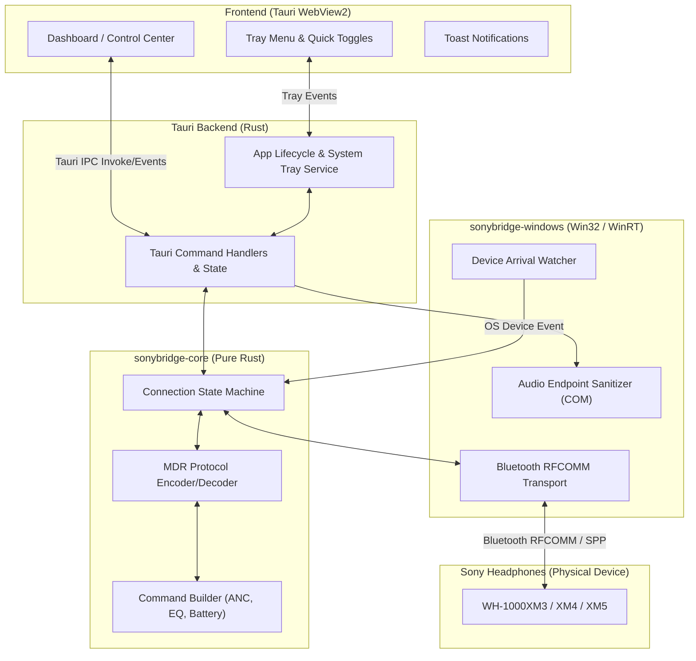

# 03 — Architecture

> Status: **APPROVED**. 🔬 = must be confirmed by a Milestone 0 spike.

## Tech stack (see `decisions/0001-rust-tauri-stack.md`)
| Concern | Choice | Rationale |
|---|---|---|
| Language / runtime | Rust (stable 2021) | Memory safety, native C/Win32 interop, zero-runtime overhead, predictable memory. |
| Desktop App & Tray | Tauri v2 | Native Windows WebView2 embedding, native OS tray menu, tiny footprint (~10-20 MB vs Electron's 150+ MB). |
| Windows Bluetooth API | `windows-rs` / WinRT (`Windows.Devices.Bluetooth.Rfcomm`) + Winsock fallback 🔬 | Official Microsoft Windows SDK bindings for Rust; provides RFCOMM socket streaming. |
| Audio Endpoint Control | Windows Core Audio COM API (`IMMDeviceEnumerator`, `IPolicyConfig`) 🔬 | Native Windows API for enumerating audio render endpoints and switching default devices. |
| UI Framework | Svelte or Vanilla TypeScript + Tailwind CSS | Ultra-lightweight reactive UI with zero heavy bundles, instant rendering. |
| Build & CI | Cargo workspace + GitHub Actions (`windows-latest`) | Fast compilation, unified workspace dependencies, automated CI gate. |

---

## Component / Process Model



---

## Module Boundaries (Designed for Parallel Work)

```
crates/
├── sonybridge-core/       # Pure protocol logic, #![forbid(unsafe_code)], zero OS deps, 100% unit-tested
│   ├── src/
│   │   ├── lib.rs
│   │   ├── protocol/      # Packet framing (0x0C start byte, seq, payload, checksum)
│   │   ├── commands/      # ANC, EQ, Battery, AutoPower, TouchSensor command schemas
│   │   ├── state.rs       # Connection & device state machine
│   │   └── models.rs      # Device profiles, EQ presets, Battery levels
│   └── tests/             # Golden packet fixtures from real packet captures
│
├── sonybridge-windows/    # Windows OS integrations (WinRT Bluetooth, Winsock, Core Audio)
│   ├── src/
│   │   ├── lib.rs
│   │   ├── bluetooth.rs   # RFCOMM socket stream & device watcher
│   │   ├── audio.rs       # Windows Core Audio endpoint routing & A2DP enforcement
│   │   └── notification.rs# Windows toast notification helper
│
├── sonybridge-cli/        # Headless diagnostic tool & M0 spike probe
│   └── src/
│       └── main.rs        # CLI for probing paired devices, packet sniffer, raw command injector
│
└── sonybridge-app/        # Tauri v2 Desktop & System Tray binary
    ├── src-tauri/
    │   ├── src/
    │   │   ├── main.rs
    │   │   ├── tray.rs    # Taskbar system tray icon & context menu
    │   │   └── commands.rs# IPC command bridges between Frontend and Core
    │   └── Cargo.toml
    └── ui/                # Frontend web application (Svelte/TypeScript)
        ├── src/
        └── index.html
```

### Dependency Rules:
1. `sonybridge-core` **MUST NEVER** import `windows`, `windows-sys`, or `tauri`. It is purely platform-agnostic and unit-testable on any OS.
2. `sonybridge-windows` implements transport traits defined by `sonybridge-core`.
3. `sonybridge-cli` depends on `core` and `windows` for rapid headless verification during spikes without needing the GUI.
4. Independent roadmap tasks touch disjoint crates, enabling parallel worker subagents.

---

## Key Technical Designs

### 1. Sony MDR Protocol Framing
- **Packet Structure:**
  - Start Byte: `0x0C` (or `0x0E` depending on series/packet type)
  - Sequence Number: 1 byte (`0x00` - `0xFF`)
  - Payload Length: 4 bytes big-endian (or 1 byte in older framing)
  - Payload: Command ID + Type + Arguments
  - Checksum: Simple 8-bit sum (`SUM(payload_bytes) & 0xFF`) or CRC
- **Handshake Sequence:**
  1. Open RFCOMM channel to Sony MDR Service UUID (`00001101-0000-1000-8000-00805F9B34FB` or Sony proprietary SPP UUID `96CC203E-5068-46AD-B32D-396CEEBE3928`).
  2. Send `CmdGetProtocolVersion` (`0x00`) → Receive Protocol capability bitmask.
  3. Send `CmdGetDeviceInfo` → Headphone model string ("WH-1000XM3").
  4. Query initial status: Battery (`0x02`), NC/Ambient Sound (`0x08`), EQ Table (`0x04`).

### 2. Windows 10 Bluetooth RFCOMM Transport 🔬 (Spike M0.2)
- Windows 10 provides `Windows.Devices.Bluetooth.Rfcomm.RfcommDeviceService`.
- If WinRT throws `AccessDenied` or fails to bind the socket when paired via Windows Settings, the transport falls back to native Winsock (`AF_BTH`, socket type `SOCK_STREAM`, protocol `BTHPROTO_RFCOMM`), binding directly to the device's Bluetooth MAC address (`BTH_ADDR`).

### 3. Audio Endpoint Sanitizer 🔬 (Spike M0.4)
- When a headset connects, Windows often sets Hands-Free AG as default communication device and sometimes mistakenly routes multimedia audio to it.
- Using `IMMDeviceEnumerator` and the undocumented but stable `IPolicyConfig` COM interface, SonyBridge can enumerate audio endpoints, identify the A2DP Stereo device matching the Bluetooth hardware address, and set it as the active default multimedia console audio device.

---

## Rejected Alternatives
- **Electron:** Rejected due to excessive memory consumption (> 150 MB RAM at idle) and bundle size (> 90 MB). A background system tray utility must stay under 35 MB RAM.
- **Pure Python (ctypes/Tkinter):** Rejected due to complex Windows installer distribution, runtime overhead, and difficulty achieving clean system tray integration without bundling heavy PyInstaller binaries.
- **Kernel-mode Virtual Audio Driver:** Rejected because user-space COM endpoint routing achieves the desired result without driver signing requirements, blue screen risks, or requiring administrator privileges.

---

## Known Limitations
- Connecting to the headphone's MDR control channel requires that the headphones are paired and connected to Windows via standard Bluetooth first.
- Simultaneous multi-point connection management is limited by the WH-1000XM3 hardware (multipoint was formally introduced in the WH-1000XM4).
