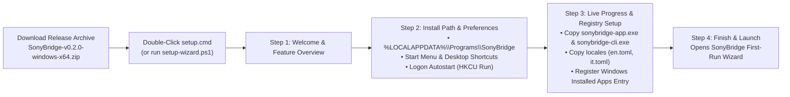
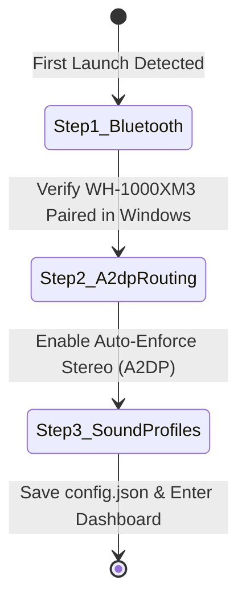

# 07 — UX Enhancements & Product Evolution (`v0.2.0`)

Following the initial `v0.1.0` architectural scaffold, SonyBridge evolved in `v0.2.0` to deliver a zero-friction Windows 10/11 user experience from download to daily system tray operation.

---

## 1. Zero-Elevation Guided Windows Setup Wizard (`scripts/setup-wizard.ps1`)

### Objective:
Provide end users with a familiar, polished Windows graphical installer (`System.Windows.Forms`) that requires **zero UAC Administrator elevation**, alongside `-NoGui` console and `-Silent` unattended modes.

---

## 2. In-App First-Run Onboarding Wizard (`crates/sonybridge-app/ui`)

When SonyBridge starts for the first time (`onboarding_completed == false` in `%APPDATA%\SonyBridge\config.json`), it launches a 3-step onboarding modal:

---

## 3. Real-World Sony WH-1000XM3 MDR v1 Wire Protocol (`#12`)

- **Byte-Stuffed RFCOMM Framing (`crates/sonybridge-core/src/protocol.rs`):**
  - Implements authentic Sony MDR v1 framing (`0x3E` start marker, `0x3C` end marker, `0x3D` escape byte with `0x10` bit mask, `0x0C` `DATA_MDR`, `0x01` `ACK`, and modulo-256 checksum over `[data_type, seq, len[0..4], payload...]`).
- **Physical WH-1000XM3 Opcodes (`crates/sonybridge-core/src/commands.rs`):**
  - `0x68` (`NCASM_SET_PARAM`): Dual Noise Sensor ANC, Wind Noise Reduction, and 20-step Ambient Sound (`1..=20`) with Voice Passthrough (`Focus on Voice`).
  - `0x58` (`EQEBB_SET_PARAM`): Hardware Clear Bass (`-10..=+10`) and 5-band Equalizer (`400Hz`, `1kHz`, `2.5kHz`, `6.3kHz`, `16kHz`).
  - `0x12` / `0x13` (`BATTERY_GET_LEVEL` / `BATTERY_RET_LEVEL`), `0x28` (`POWER_OFF_SET_PARAM`), and `0xD8` (`SYSTEM_SET_PARAM` touch panel lock).

---

## 4. 3-Tab Adaptive Flyout & 1-Click Sound Profiles (`#13`, `#14`)

- **Tab 1 — 🎛️ Dashboard & EQ:** 1-click Sound Profile bar (*Focus*, *Office / Calls*, *Cinema / Bass Boost*, *Studio Reference*), ANC/Wind/Ambient segmented selector, Voice Passthrough toggle, Clear Bass slider, and 5-band EQ sliders.
- **Tab 2 — 🪟 Windows & Power:** 1-click **Enforce High-Res Stereo (A2DP)** button (`IPolicyConfig::SetDefaultEndpoint`), Auto-Switch A2DP on Connect toggle, Start with Windows (`HKCU\...\Run`) toggle, Auto-Power Off selector, and Right-Ear Touch Sensor lock.
- **Tab 3 — 🔬 Architecture & Wire Inspector:** Live hexadecimal wire frame inspector displaying the exact MDR v1 byte-stuffed packet transmitted on every slider or button interaction, plus 1-click RFCOMM diagnostic probe.
