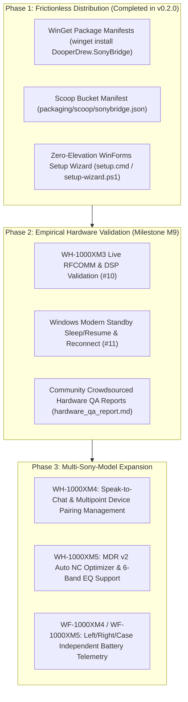

# 08 — Community Growth, Distribution & Multi-Model Roadmap

This document serves as the **strategic master plan and distribution guide** for **SonyBridge** across Windows package managers and the Sony wireless audio ecosystem.

---

## 1. Strategic Roadmap



---

## 2. Pillar 1: Frictionless Distribution Channels

### 2.1 Microsoft WinGet (`winget install DooperDrew.SonyBridge`)
- **Status:** Official `1.9.0` multi-file manifests (`DooperDrew.SonyBridge.yaml`, `.installer.yaml`, `.locale.en-US.yaml`) and singleton manifest generated in [`packaging/winget/`](../packaging/winget/) via [`scripts/generate-manifests.ps1`](../scripts/generate-manifests.ps1).
- **Local Installation & Validation:**
  ```powershell
  winget validate --manifest .\packaging\winget\manifests\d\DooperDrew\SonyBridge\0.3.0\
  winget install --manifest .\packaging\winget\manifests\d\DooperDrew\SonyBridge\0.3.0\
  ```
- **Upstream Submission to `microsoft/winget-pkgs`:**
  1. Fork [`microsoft/winget-pkgs`](https://github.com/microsoft/winget-pkgs).
  2. Copy `packaging/winget/manifests/d/DooperDrew/SonyBridge/0.3.0/` into `manifests/d/DooperDrew/SonyBridge/0.3.0/`.
  3. Open a Pull Request to `microsoft/winget-pkgs`.

### 2.2 Scoop Package Manager
- **Status:** Manifest generated in [`packaging/scoop/sonybridge.json`](../packaging/scoop/sonybridge.json) with automated SHA256 hash and `autoupdate` rules.
- **Direct Installation:**
  ```powershell
  scoop install https://raw.githubusercontent.com/DooperDrew/sonybridge/main/packaging/scoop/sonybridge.json
  ```

### 2.3 Zero-Build Portable Release ZIP & Setup Wizard
Every GitHub Release attaches `SonyBridge-v<version>-windows-x64.zip` containing:
- `sonybridge-app.exe` — Native Windows 10/11 system tray companion
- `sonybridge-cli.exe` — Headless Bluetooth RFCOMM & Core Audio diagnostic CLI
- `setup.cmd` & `setup-wizard.ps1` — Zero-elevation Windows Forms graphical setup wizard (`-Silent`, `-NoGui`)
- `install.ps1`, `uninstall.ps1` & `installer.iss` — User-space installer, uninstaller, and Inno Setup script
- `locales/en.toml` & `locales/it.toml` — Bilingual English and Italian UI strings
- `README.md`, `user-guide.md`, `CHANGELOG.md`, `LICENSE`

---

## 3. Competitive Value Proposition

| Solution | Price | Idle RAM | Kernel Drivers Required? | Hardware 5-Band EQ & Clear Bass? | Auto A2DP Stereo Enforcement? |
|---|---|---|---|---|---|
| **SonyBridge** | **Free & Open Source (MIT)** | **`~22 MB` (`0%` CPU)** | **No (100% User-Mode)** | **Yes (Direct EEPROM `0x58`)** | **Yes (`IPolicyConfig` COM)** |
| Windows Built-In Bluetooth | Free | N/A | Inbox | No | No (defaults to muffled HFP on mic use) |
| Paid Third-Party Tray Apps | $10–$25 | 40–150 MB | Often Virtual Audio Driver | Partial | Manual |
