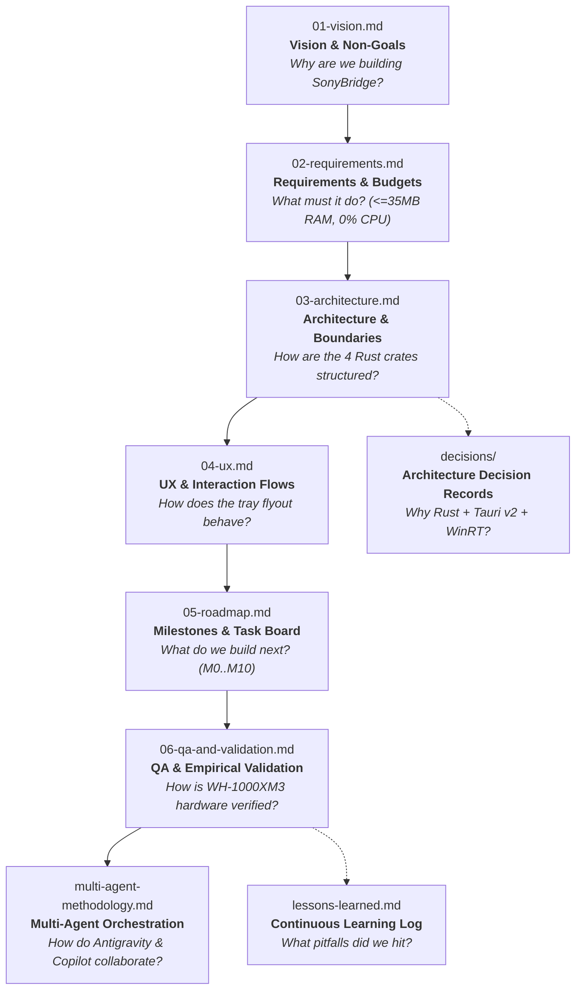

# SonyBridge Documentation System

This directory contains the specification and governance documents that define the architecture and lifecycle of **SonyBridge**, built with the **Project Kickstart** methodology.

In an agent-assisted or autonomous engineering environment, **the codebase specifications are the primary interface between human intent and AI execution**. Keeping technical truth in version-controlled markdown files prevents context drift, hallucinated constraints, architectural fragmentation, and abandoned conventions.

---

## 📚 Specification Hierarchy & Reading Order

Whenever an agent or developer enters the workspace, documents must be consulted in this exact sequence before any code is generated or modified:

---

## 🗂️ Document Inventory

| File | Purpose | Key Content & Conventions |
|---|---|---|
| [`01-vision.md`](01-vision.md) | **North Star** | Problem statement (Windows Bluetooth HFP/A2DP pain + Sony MDR features), user personas, guiding principles, and non-goals. |
| [`02-requirements.md`](02-requirements.md) | **Functional & Non-Functional Specs** | MoSCoW-prioritized features (`F1`–`F6`), quantitative budgets (`<= 35 MB` idle RAM, `0%` idle CPU), and safety invariants. |
| [`03-architecture.md`](03-architecture.md) | **Structural Blueprint** | 4-crate Cargo workspace (`sonybridge-core`, `sonybridge-windows`, `sonybridge-cli`, `sonybridge-app`), Mermaid diagrams, and crate boundaries. |
| [`04-ux.md`](04-ux.md) | **Interaction Model** | 3-tab glassmorphic tray flyout, 1-click Sound Profiles, First-Run Onboarding Wizard, and bilingual EN/IT localization. |
| [`05-roadmap.md`](05-roadmap.md) | **Single Source of Truth for Work** | Milestones `M0` through `M10` mapped 1:1 to GitHub Milestones and Issues (`#1`–`#15`). |
| [`06-qa-and-validation.md`](06-qa-and-validation.md) | **Empirical Proof & Test Matrices** | Automated test suite verification (`Pass`) and physical Sony WH-1000XM3 hardware validation matrix (`Pending` in Milestone `M9`). |
| [`07-ux-and-improvements.md`](07-ux-and-improvements.md) | **v0.2.0 Product Evolution** | Byte-stuffed MDR v1 wire protocol (`0x3D`), 3-tab UI, hex wire inspector, and interactive `setup.cmd` wizard. |
| [`08-community-and-growth-strategy.md`](08-community-and-growth-strategy.md) | **Distribution & Packaging** | Portable `.zip` release bundles (`SonyBridge-vX.Y.Z-windows-x64.zip`) and Scoop/WinGet manifests. |
| [`multi-agent-methodology.md`](multi-agent-methodology.md) | **Parallel & Cloud Agent Orchestration** | Hub-and-Spoke model, Sole Committer Protocol, complexity tiers, GitHub Copilot cloud agent integration, and Draft PR workflows. |
| [`m0-spike-findings.md`](m0-spike-findings.md) | **M0 Protocol & Core Audio Ground Truth** | Sony MDR v1/v2 RFCOMM service UUIDs, byte-stuffed packet layout, and Windows `IPolicyConfig` COM vtable layout. |
| [`user-guide.md`](user-guide.md) | **End-User Manual** | Installation (`setup.cmd`), tray controls, Sound Profiles, A2DP audio enforcement, and CLI diagnostics. |
| [`decisions/`](decisions/) | **Architecture Decision Records (ADR)** | [`0000-template.md`](decisions/0000-template.md) and [`0001-rust-tauri-stack.md`](decisions/0001-rust-tauri-stack.md). |
| [`lessons-learned.md`](lessons-learned.md) | **Living Memory & Rules Engine** | Feedback log turning user corrections and debugging insights into enforceable engineering rules (`project` and `[KIT]`). |
| [`model-fallback-log.md`](model-fallback-log.md) | **Model Routing & Quota Audit** | Audit log tracking tasks run on fallback models. |
| [`release-methodology.md`](release-methodology.md) | **Release Engineering** | SemVer definitions, `package-release.ps1` + `generate-manifests.ps1` pipeline, and GitHub Releases workflow. |

---

## 🔬 Core Working Agreements for Documentation

### 1. Claims Follow Evidence
Never write assertions into technical documents that have not been tested or measured.
- If an architectural assumption is unproven, mark it with **🔬 (spike)**.
- In [`06-qa-and-validation.md`](06-qa-and-validation.md), physical WH-1000XM3 hardware rows remain **`Pending`** (tracked in open GitHub Issues `#10` and `#11`) until empirical evidence is produced.
- Avoid marketing buzzwords ("pioneering", "blazing fast", "zero bugs") in technical specs.

### 2. Living Knowledge Loop
When a developer corrects a design or an agent makes a mistake:
1. Do not merely apologize or fix the code in isolation.
2. Record the root cause and the new preventative rule in [`lessons-learned.md`](lessons-learned.md).
3. If the rule is universally binding across all conversations, promote it to [`AGENTS.md`](../AGENTS.md) and [`.github/copilot-instructions.md`](../.github/copilot-instructions.md).

### 3. Disjoint Modules for Parallel Workers
[`03-architecture.md`](03-architecture.md) enforces that independent components live in separated Cargo crates (`sonybridge-core`, `sonybridge-windows`, `sonybridge-cli`, `sonybridge-app`). This enables multi-agent swarms (`project-worker` subagents and GitHub Copilot Agent) to work concurrently in isolated git worktrees or branches without causing merge conflicts.
