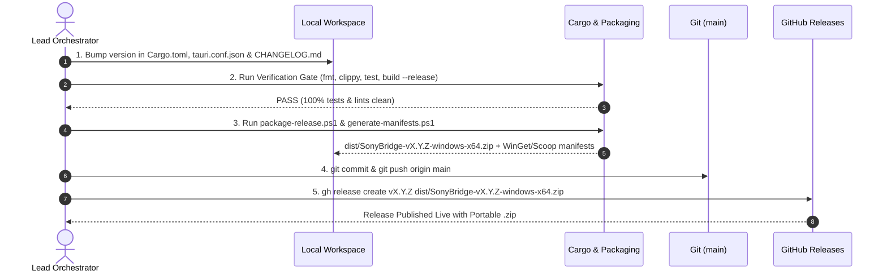

# Release & Versioning Methodology

## 1. Semantic Versioning (SemVer)

| Component | Increment Trigger | Examples in SonyBridge |
|---|---|---|
| **MAJOR** (`X.0.0`) | Breaking architecture shifts, incompatible config schema changes, or graduation to production `v1.0.0`. | `v1.0.0`: General availability release after physical WH-1000XM3/XM4/XM5 hardware sign-off. |
| **MINOR** (`0.X.0`) | New backward-compatible features, UX enhancements, installers, or additional Sony headphone models. | `v0.2.0`: Real WH-1000XM3 MDR v1 byte-stuffed protocol, `IPolicyConfig` A2DP enforcer, 3-tab UI, Sound Profiles, WinForms Setup Wizard, WinGet/Scoop manifests.<br/>`v0.3.0`: Single unified executable (`sonybridge-app probe`), standalone installer (`SonyBridge-Setup.exe`), dynamic tray telemetry, in-app maintenance tools, and automated accessibility hardening (`ui-qa-tester`). |
| **PATCH** (`0.X.Y`) | Bug fixes, RFCOMM timing adjustments, translation updates. | `v0.2.1`: Bluetooth reconnection backoff tuning, locale refinements. |

---

## 2. Single Source of Truth (SSOT)

All project versions derive from the workspace root [`Cargo.toml`](../Cargo.toml) (`[workspace.package] version`) and [`crates/sonybridge-app/tauri.conf.json`](../crates/sonybridge-app/tauri.conf.json). Packaging scripts ([`scripts/package-release.ps1`](../scripts/package-release.ps1), [`scripts/generate-manifests.ps1`](../scripts/generate-manifests.ps1), and [`scripts/setup-wizard.ps1`](../scripts/setup-wizard.ps1)) automatically read this version string.

---

## 3. The 5-Step Official Release Procedure

Every official release MUST follow this protocol executed by the **Lead Orchestrator (Sole Committer)**:



### Step 1: Version Bump & Changelog Preparation
1. Update `version = "X.Y.Z"` in root [`Cargo.toml`](../Cargo.toml) and [`crates/sonybridge-app/tauri.conf.json`](../crates/sonybridge-app/tauri.conf.json).
2. Add a comprehensive entry in [`CHANGELOG.md`](../CHANGELOG.md).
3. Update release download links in [`README.md`](../README.md) and [`docs/user-guide.md`](user-guide.md).

### Step 2: Quality Verification Gate
```powershell
$env:PATH = "$env:USERPROFILE\.cargo\bin;$env:PATH"
cargo fmt --all -- --check
cargo clippy --workspace --all-targets -- -D warnings
cargo test --workspace
cargo build --workspace --release
```

### Step 3: Release Packaging & Distribution Manifests
```powershell
.\scripts\package-release.ps1 -Version "X.Y.Z" -SkipBuild
.\scripts\generate-manifests.ps1 -Version "X.Y.Z"
```
This produces:
1. `dist/SonyBridge-v<version>-windows-x64.zip` containing:
   - `sonybridge-app.exe` & `sonybridge-cli.exe`
   - `locales/` (`en.toml`, `it.toml`)
   - `setup-wizard.ps1` & `setup.cmd` (Zero-elevation WinForms GUI + `-Silent` + `-NoGui` wizard)
   - `install.ps1`, `uninstall.ps1`, & `installer.iss`
   - `user-guide.md`, `README.md`, `CHANGELOG.md`, `LICENSE`
2. **WinGet Manifests:** `packaging/winget/manifests/d/DooperDrew/SonyBridge/<version>/` (`DooperDrew.SonyBridge.yaml`, `.installer.yaml`, `.locale.en-US.yaml`) + singleton `packaging/winget/DooperDrew.SonyBridge.yaml`.
3. **Scoop Manifest:** `packaging/scoop/sonybridge.json` (auto-populated with latest SHA256 hash and release download URL).

### Step 4: Git Commit & Push
```powershell
git add -A
git commit -m "release: vX.Y.Z"
git push origin main
```

### Step 5: GitHub Release Publication
```powershell
gh release create vX.Y.Z "dist\SonyBridge-vX.Y.Z-windows-x64.zip" --title "SonyBridge vX.Y.Z — <Title>" --notes "..." --latest
```
*(In addition, pushing a `v*` tag triggers [`.github/workflows/release.yml`](../.github/workflows/release.yml) in GitHub Actions.)*
